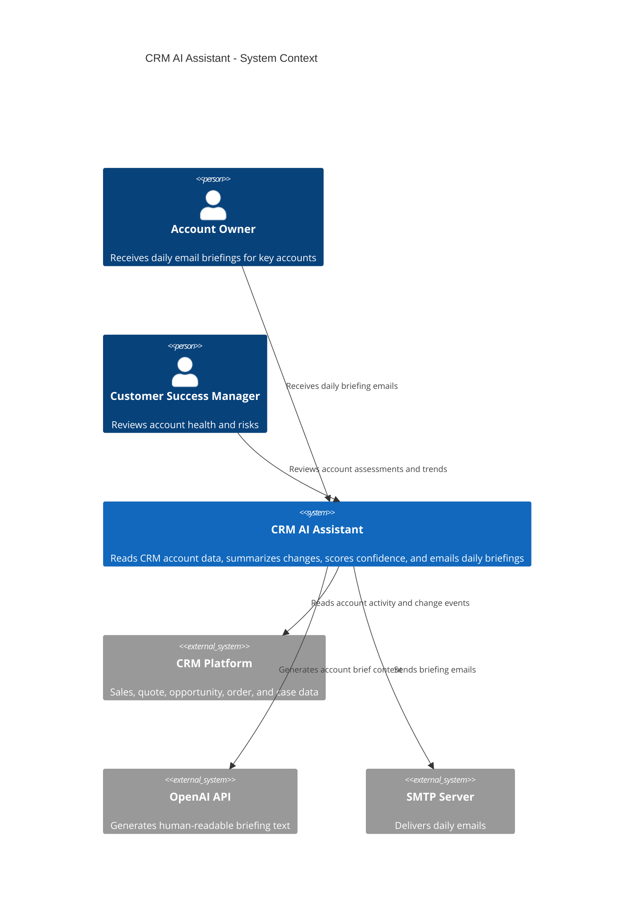
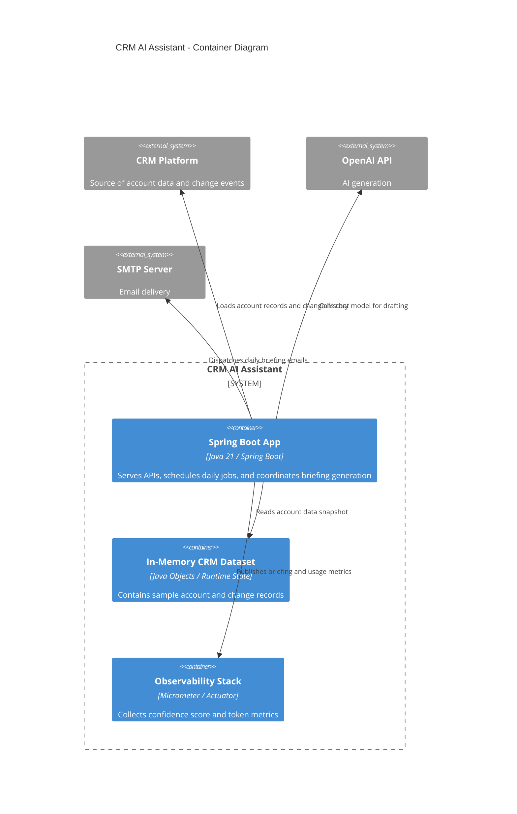
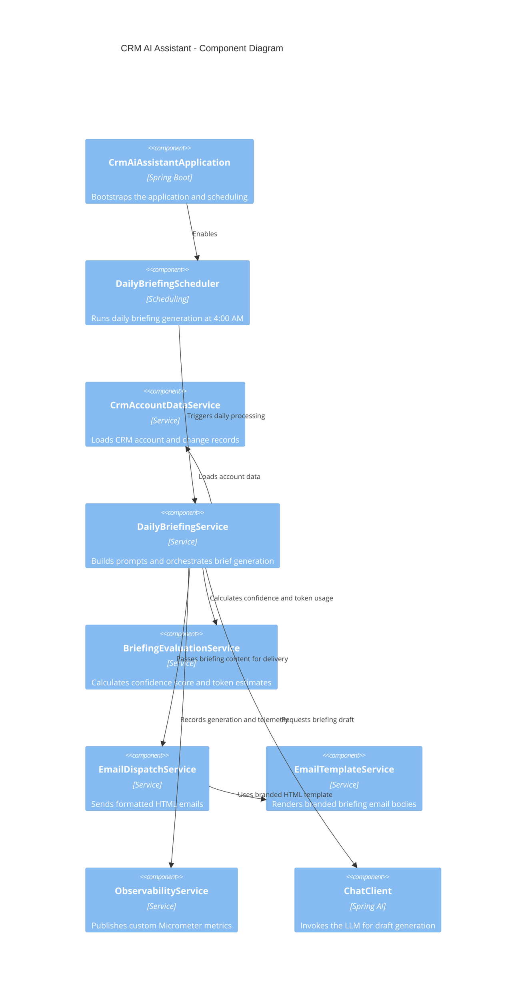

# CRMAIAssistant

CRMAIAssistant is a Spring Boot + SpringAI application that reads a batch of CRM accounts, summarizes recent changes such as leads, quotes, opportunities, orders, and support items, and creates a daily briefing email for each account.

## Features

- Reads 50 sample CRM accounts
- Tracks change events across leads, quotes, opportunities, orders, and cases
- Uses SpringAI to draft a customer-facing daily briefing email
- Sends the briefing via JavaMail
- Exposes health and metrics endpoints for observability
- Records confidence scores and token usage in Micrometer

## C4 model diagrams







## Run locally

```bash
mvn spring-boot:run
```

Then open:

- http://localhost:8081/api/health
- http://localhost:8081/api/accounts
- http://localhost:8081/api/briefings/generate
- http://localhost:8081/actuator/metrics

## Configure AI and email

```bash
export OPENAI_API_KEY=your-key
export OPENAI_MODEL=gpt-4o-mini
export SMTP_HOST=localhost
export SMTP_PORT=1025
```

## Observability

The app exposes Micrometer metrics including:

- `crm.ai.briefings.generated`
- `crm.ai.confidence.score`
- `crm.ai.token.usage`

These are visible through the Actuator endpoints.
